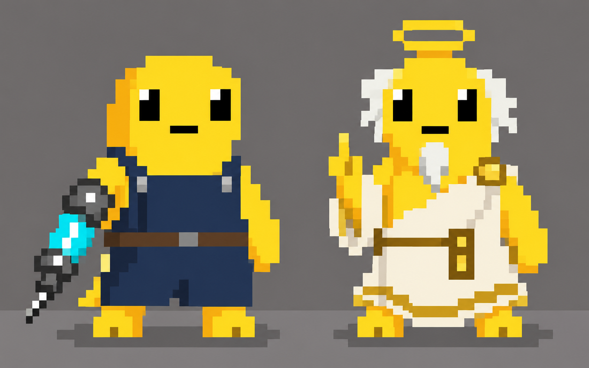

# 很忙，在给苏打饼干打孔！ · 世界观设定

版本：2026-10-15，第一版。标「已定」的是用户定下的设定；标「草案」的是 Claude 根据现有玩法提出的建议，等用户确认或改写。后续会继续补充。

## 一句话

2078 年的奶龙小镇，苏打饼干没有孔，违背了上帝的旨意。上帝说苏打饼干一定要有孔，于是创造了针头奶龙，给小镇上所有的苏打饼干打孔。

## 已定

| 项目 | 设定 |
| --- | --- |
| 游戏名 | 《很忙，在给苏打饼干打孔！》（暂定，原名《雷霆大针管》） |
| 基调 | 无厘头搞笑，梗多节奏快 |
| 平台 | 先用网页做 demo，后续可能改成 app |
| 时间 | 2078 年 |
| 地点 | 奶龙小镇（现有游戏里的「饼干镇」改名为奶龙小镇） |
| 起因 | 小镇的苏打饼干都没有孔，违背了上帝的旨意 |
| 上帝的旨意 | 苏打饼干一定要有孔 |
| 主角 | 针头奶龙：上帝为了给小镇所有苏打饼干打孔而创造的奶龙 |
| 主角的行事方式 | 针头奶龙按照上帝的指令去做事 |
| 主线 | 遵循上帝的意志：让奶龙小镇的苏打饼干都有孔 |
| 游戏类型 | 苏打饼干打孔 + 开店的模拟经营游戏 |
| 主要玩法 | 小镇模式：给苏打饼干打孔、开店卖饼干，赚取金币，解锁新的店铺和新的关卡 |
| 画风 | 像素风 |

## 角色概念图

| 角色 | 样子 |
| --- | --- |
| 针头奶龙（左） | 黄色奶龙，穿深蓝背带工装、系棕色皮带，手持装着蓝色液体的针管（图里是冰蓝皮肤，游戏默认仍是雷电黄） |
| 上帝（右） | 也是一只奶龙，头顶光环，白发白胡子，穿金边白袍，竖着一根手指下指令 |

## 小镇设计

暂定建筑如下，后续可能添加。

| 建筑 | 作用 |
| --- | --- |
| 主角家 | 有一座十字架神台；点击神台祈祷，上帝对针头奶龙进行改造升级（取代 demo 里的改装店） |
| 饼干店 | 开店卖饼干 |
| 植发店 | 待定 |
| 纹身店 | 待定 |

和现在 demo 的差别：demo 的四个地点是加工厂、饼干店、袋鼠外卖、改装店。改装店的升级改到主角家的神台；加工厂和袋鼠外卖是否保留待定。

## 草案（待确认）

把现有玩法和上面的设定对上，供讨论：

| 现有元素 | 设定里的解释 |
| --- | --- |
| 雷霆大针管 | 上帝赐给针头奶龙的神器，靠闪电充能 |
| 只能倾斜手机控制 | 雷霆大针管只听针头奶龙身体的平衡，手指碰不动它 |
| 黑白灰三种力度 | 上帝要的孔分深浅，扎穿的黑孔最虔诚 |
| 眨眼挑战 | 针头奶龙打孔太专注，会忘记眨眼 |
| 落灰 | 2078 年的小镇空气里飘着面粉灰，盖住了饼干 |
| 黄金 / 翡翠饼 | 上帝特别祝福过的饼干，藏在灰下面 |
| 神台改造 | 钢铁手腕、机械眼、夜猫子基因等升级，都是上帝听了祈祷后对针头奶龙的改造 |
| 袋鼠外卖 | 小镇的袋鼠外卖员，把打好孔的饼干送到镇外 |
| 金币 | 现有游戏里的 ¥ 改成金币，用来解锁店铺和关卡 |

## 待补充

- 植发店、纹身店的玩法；还会添加哪些建筑
- 加工厂、袋鼠外卖是否保留
- 关卡怎么随店铺解锁（例如每开一家店解锁一批关卡）
- 上帝在游戏里是否出场（例如发布每日旨意 = 定制单）
- 其他奶龙和镇民角色
- 像素风下的小镇、店铺场景和其他角色设计
